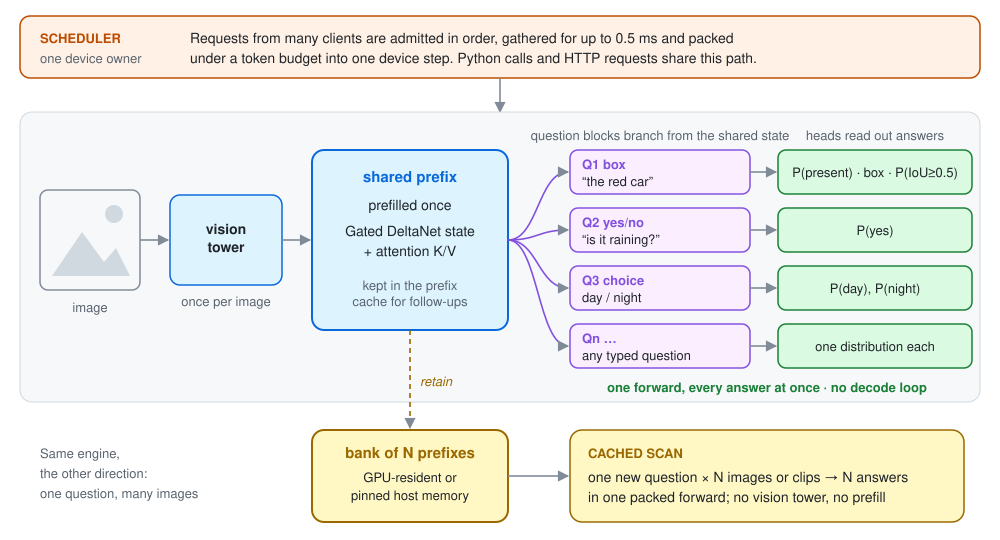

# Architecture

Glance is a decision model: a Qwen3.5-4B backbone with LoRA and small readout heads that answers typed questions (box, yes/no, choice, score) with probabilities instead of generated text. This engine serves it. Two observations shape the design:

1. **Questions share their image.** Every question about one image reads the same prefix: the image tokens and everything before them. A generative server can cache that prefix, but each question still decodes its own answer token by token. Glance only needs one forward pass over each question block and a head on its last hidden state.
2. **The backbone is hybrid.** Qwen3.5 interleaves Gated DeltaNet (GDN) linear-attention layers, which carry a fixed-size recurrent state, with full-attention layers, which carry K/V. A reusable prefix is therefore a recurrent state plus K/V per layer. Reusing the state for many questions, or many states for one question, is where most of the engineering went.

<picture>
  <source media="(prefers-color-scheme: dark)" srcset="assets/architecture-dark.svg">
  
</picture>

## Request path

| Stage | What happens | Code |
|---|---|---|
| Admission | An asyncio FIFO gathers requests for up to 0.5 ms from the oldest arrival, under an 8,192-token budget and a 64-request cap. One executor thread owns the GPU. | [`speed/scheduler.py`](../speed/scheduler.py) |
| Grouping | The device worker checks exact tokenized lengths, splits at image and question boundaries, and groups cache hits, one-question images and multi-question images. | [`speed/decision_worker.py`](../speed/decision_worker.py) |
| Vision | Images are uploaded as compact uint8 RGB, patchified on the device and run through the vision tower, batched by spatial grid. | [`scan/vision_prep.py`](../scan/vision_prep.py), [`speed/frame_pixels.py`](../speed/frame_pixels.py) |
| Prefill | Prefixes and question blocks run in one packed, variable-length LM forward. | [`scan/varlen.py`](../scan/varlen.py), [`speed/engine.py`](../speed/engine.py) |
| Readout | Box and typed heads read the last hidden state of each question block. | [`speed/box_readout.py`](../speed/box_readout.py) |
| Delivery | Answers are routed back by request, image and question. Failed batches on OOM are split and retried. | [`speed/decision_worker.py`](../speed/decision_worker.py) |

The Python API ([`glance_engine.Glance`](../glance_engine/api.py)) calls the same device worker directly, so it batches, caches and reads out exactly as the server does.

## One prefill, many questions

A request with Q questions about one image becomes one token sequence per image: the prefix (chat header, image tokens) followed by Q question blocks. The fused engine ([`speed/engine.py`](../speed/engine.py)) arranges the computation so that the expensive parts run once:

- **Shared token buffer.** Prefix tokens and question tokens sit in one buffer. Every norm, projection and MLP runs once over all of them, as one GEMM. Only the sequence mixers (GDN and attention) see the prefix and the blocks separately, exactly as in the reference forward.
- **Branch mixers.** Each question block continues from the prefix's final GDN state and attends to the prefix K/V plus its own block. The question kernels ([`speed/gdn_branch.py`](../speed/gdn_branch.py)) read the shared FP32 state and K/V in place instead of materializing a copy per question. In the reference implementation, 704 prefix slots created 1,536 MiB of recurrent-state copies and 704 MiB of K/V gathers across layers. [Measurements](../outputs/engine_opt/04_gdn_branch/raw/item4_staged_micro.json)
- **Heads instead of decoding.** A box question returns P(present), a box and P(IoU ≥ 0.5) from the box head; typed questions return a distribution over their labels. There is no decode loop, so 32 questions cost little more than one: 48.9 ms against 37.7 ms for one question on a ≤640-token image. [Measurement](../outputs/engine_opt/09_numerics/raw/item9_release_speed.json)
- **Host-built indices and CUDA graphs.** All gather and scatter indices are built on the host during collation, so the LM and heads have no device-to-host syncs and are captured as CUDA graphs per shape bucket (prefix length a multiple of 64, block count a power of two, block length a multiple of 16). Left padding is exact: padded GDN inputs are zero and padded keys are masked.
- **Prefix cache.** With `cache=true` the worker keeps the image's per-layer GDN state, conv tail, attention K/V and visual hidden states in a byte-bounded LRU (8 GiB by default). A follow-up question skips the vision tower and prefill. Retained prefixes are built in a singleton layout so later reuse sees a stable BF16 state.

## One question, many images: banks

The scan engine ([`scan/engine.py`](../scan/engine.py)) turns the same idea around. `encode(units)` prefills N images or short clips once and keeps a **bank**: for every unit, the GDN state and conv tail of each linear-attention layer, the post-RoPE K/V of each full-attention layer, the visual hidden states, and the box head's query-independent key projection. `query(bank, q)` then runs N short branches, one copy of the question block per unit, in a single forward: no vision tower and no prefill.

| Bank detail | Value | Source |
|---|---|---|
| Fixed state per prefix (24 GDN layers) | 48 MiB FP32 recurrent state + 1.125 MiB conv tail | [FINDINGS](../outputs/engine_opt/FINDINGS.md#cached-image-queries-retain-a-large-fixed-state-cost) |
| Resident storage, Tv640 image | 75.49 → 72.87 MiB after compact lossless K/V | [Item 8](../outputs/engine_opt/08_bank_memory/summary.md) |
| Formats | `legacy`, `compact`, `state_packed` (lossless); `state_bf16`, `state_fp8`, `state_int8`, `kv_fp8`, `state_kv_fp8` (lossy, opt-in) | [`scan/bank.py`](../scan/bank.py) |
| Pinned-host tier | 1,024 four-frame clips: 1,010.5 ms from pinned memory (53.64 GB over PCIe) against 963.0 ms GPU-resident | [Item 8](../outputs/engine_opt/08_bank_memory/raw/item8_coalesced_tier_packed.json) |

The lossless `state_packed` format stores FP32 recurrent state as 128-value groups with a local exponent window ([`scan/bank_codec.py`](../scan/bank_codec.py)) and decodes it on the GPU ([`scan/bank_kernels.py`](../scan/bank_kernels.py)). The host tier ([`scan/host_bank.py`](../scan/host_bank.py)) keeps banks in pinned memory and streams chunks through two reusable device staging slots, so a scan can exceed GPU memory at close to the PCIe floor: a 10,000-entry traversal moved 523.81 GB in 9.333 s against a 9.211 s floor.

A bank pays for itself quickly. On a newly encoded bank of 64 inputs, with changing questions and graph capture charged, cumulative cached time beat repeated fresh scans from the second question for four-frame clips, Tv640 and Tv256 images, and from the fifth for Tv64 images. [Finding](../outputs/engine_opt/FINDINGS.md#strongest-findings)

The [`Scanner`](../scan/api.py) wraps this into one call that returns per-image answers and a set-level answer. After `calibrate(negative_scans)`, `none_conformal` is a "not in any of these" verdict from a max-statistic split-conformal rule ([`scan/setlevel.py`](../scan/setlevel.py)): on scans that do not contain the target, its false-alarm rate is at most α, averaged over calibration draws. The guarantee bounds false alarms, not misses.

## Fresh scans: packed variable-length prefill

When the images are new, `fresh(images, q)` packs every image prefix with its own question into one variable-length sequence batch ([`scan/varlen.py`](../scan/varlen.py)). The packing removed repeated CUDA graph captures that had dominated the old chunked path (128 frames at Tv128: 2,586.2 → 931.1 ms in item 1). Later items fused preprocessing and vision operations with the reference BF16 rounding, fused the SwiGLU epilogue, and added an optional SM120 GDN prefill. [Item summaries](../outputs/engine_opt/SUMMARY.md)

Fresh scans are prefill-bound for every engine, so this is where Glance's lead is smallest: vLLM BF16 takes 3–24% longer across the eight fresh cells. [Performance](performance.md)

## Kernels

All custom kernels are optional; when a requirement is missing the engine keeps the reference PyTorch or FLA operation and the answers stay within the same gates. `python -m glance_engine.kernels` reports what is available.

| Kernel | Purpose | Needs |
|---|---|---|
| [`speed/lm_prefill.py`](../speed/lm_prefill.py) | Packed BF16 LM prefill: gated norm, conv taps, head norm, fused SwiGLU epilogue | Triton, SM120 |
| [`speed/gdn_branch.py`](../speed/gdn_branch.py) | Output-only GDN continuations of many branches from one read-only FP32 state | Triton, SM120 |
| [`speed/flash_gdn.py`](../speed/flash_gdn.py) | Chunked GDN prefill with FlashQLA's 64-wide value tile on large packed calls | `[sm120-prefill]`, SM120 |
| [`speed/box_scores_kernel.py`](../speed/box_scores_kernel.py) | Box centre scores with one fixed reduction tree per patch | Triton |
| [`speed/vision_mlp.py`](../speed/vision_mlp.py), [`speed/vision_rotary.py`](../speed/vision_rotary.py) | Fused vision MLP + GELU; vision RoPE from one strided QKV | Triton |
| [`speed/frame_pixels.py`](../speed/frame_pixels.py) | Patchify compact uint8 frames on the device | Triton |
| [`scan/bank_kernels.py`](../scan/bank_kernels.py) | Decode lossless bank state and gather into the clip layout | Triton |
| [`speed/w12.py`](../speed/w12.py) | Opt-in lossless packed BF16 weights for bandwidth-bound projections | nvcc + Ninja, SM120 |

The SM120 GDN prefill is enabled by installing `.[sm120-prefill]` and launching with `FLA_FLASH_QLA=0`, which keeps FLA's own dispatcher on its chunk-64 kernel for the calls Glance does not route to FlashQLA.

## Repository map

| Path | Contents |
|---|---|
| [`glance_engine/`](../glance_engine) | Public API (`Glance`, typed questions), checkpoint loading, `glance-serve`, kernel report, and stable re-exports: `glance_engine.engine`, `.serving`, `.banks` |
| [`speed/`](../speed) | Fused single-image engine, kernels, scheduler, device worker, HTTP server, single-image and serving benchmarks |
| [`scan/`](../scan) | Scan engine, banks and host tier, packed fresh prefill, set-level rules, scan benchmarks and the exactness suite |
| [`tests/`](../tests), `speed/test_*.py`, `scan/test_bank.py` | CPU test suite (`pytest`) |
| [`examples/`](../examples) | Runnable quickstart, cached scan and HTTP client |
| [`outputs/engine_opt/`](../outputs/engine_opt) | Optimization series: per-item reports, raw timings and equivalence logs |
| [`demo/`](../demo) | README animations, their measured timelines and image credits |
| `scan/vm/`, `speed/*.sh` | GPU VM runners used for every measurement |

The engine code still lives in `speed/` and `scan/` because work on those paths is ongoing; `glance_engine.engine`, `glance_engine.serving` and `glance_engine.banks` are the import paths to depend on.
